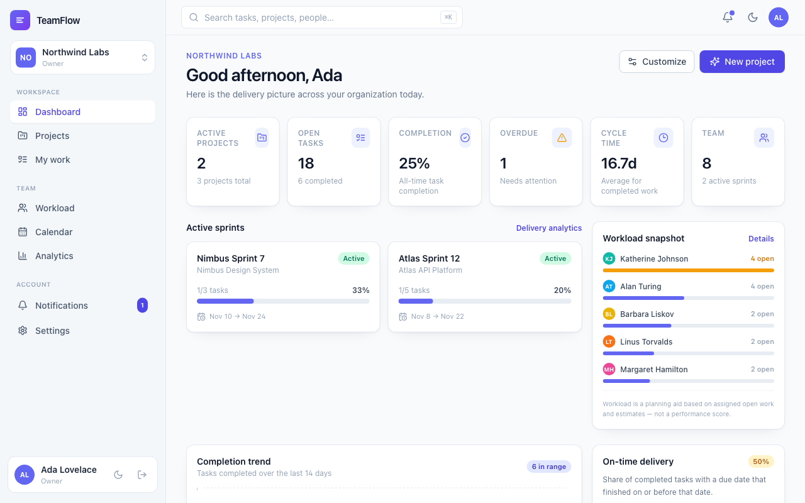
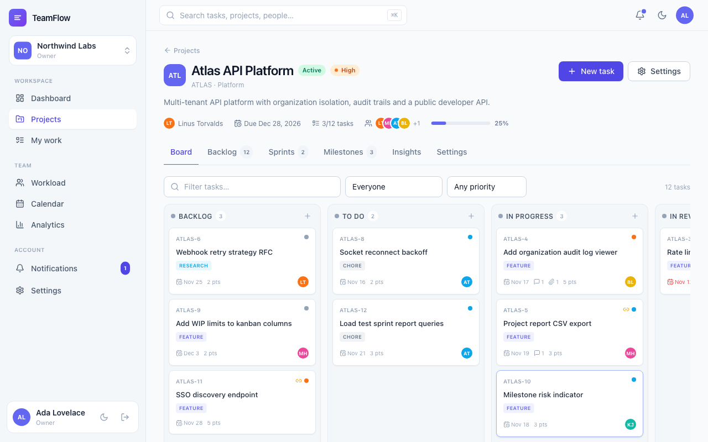
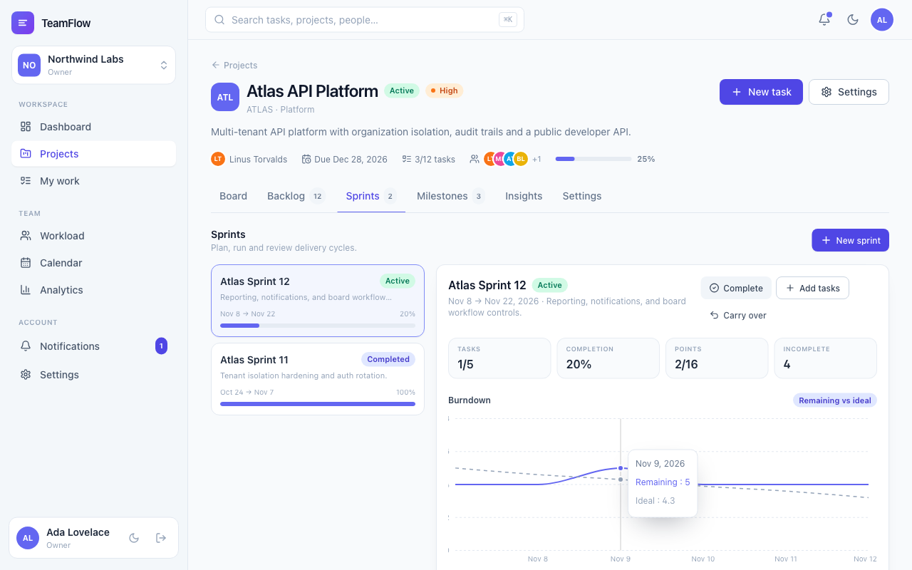
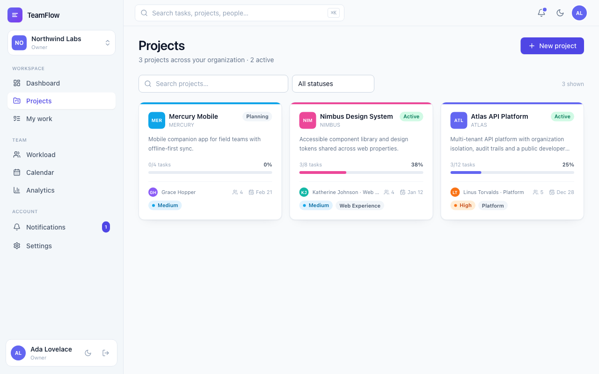
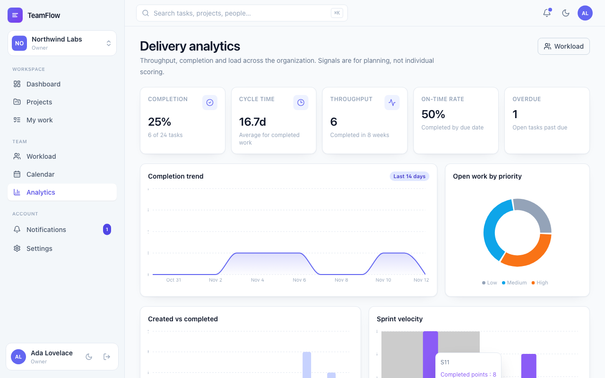
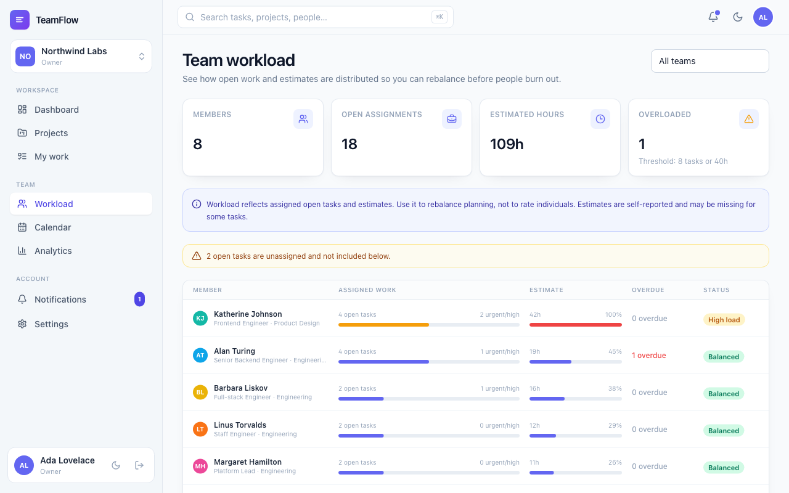
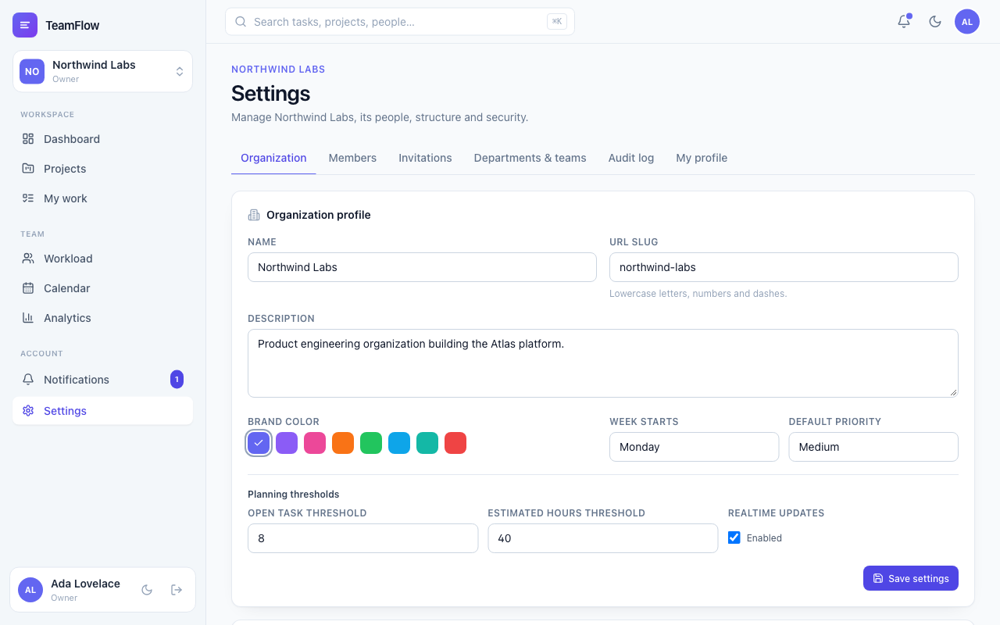
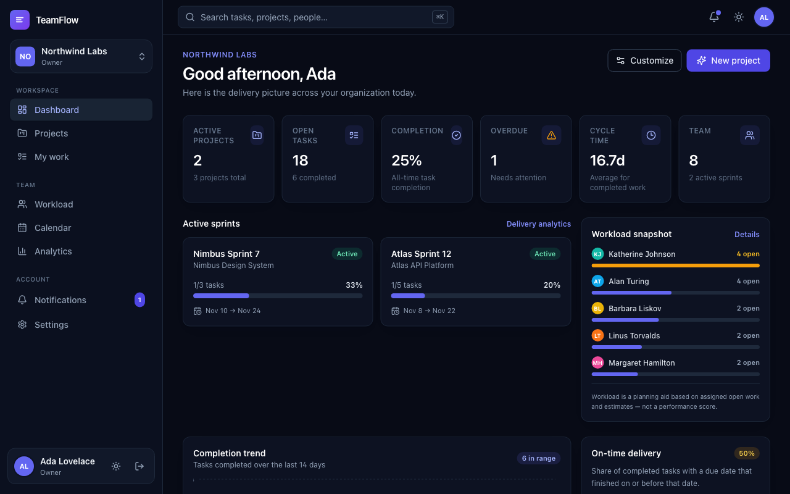

# TeamFlow

**Engineering team management for projects, sprints, workload, and delivery signals.**

TeamFlow is a full-stack, multi-tenant SaaS application built to demonstrate production-minded architecture: relational data modeling, organization-level isolation, backend-enforced permissions, real-time collaboration, file uploads, analytics, and an enterprise-style React interface.



## What it demonstrates

- **Multi-tenant architecture** — organizations → departments → teams → memberships, with every tenant-owned row scoped by `organizationId`.
- **Backend-enforced RBAC** — Owner, Admin, Project Manager, Team Lead, Developer, and read-only roles, plus project-level managers/contributors/viewers. Cross-organization requests resolve as `404`, never as data leakage.
- **Secure sessions** — scrypt password hashing, short-lived JWT access cookies, hashed rotating refresh tokens, CSRF double-submit, origin checks, rate limits, and audit logs.
- **Real delivery workflows** — configurable Kanban columns with drag-and-drop, task dependencies, comments, attachments, sprints with burndown and reports, milestones, and calendar events.
- **Analytics with intent** — throughput, cycle time, completion trends, sprint velocity, and workload distribution presented as planning signals, explicitly not employee performance scores.
- **Testing** — 22 API integration tests covering auth, tenant isolation, permissions, task/sprint workflows, database constraints, and Socket.IO events; 4 Playwright end-to-end flows.

## Screenshots

| Kanban board | Sprint planning & burndown |
| --- | --- |
|  |  |

| Projects | Delivery analytics |
| --- | --- |
|  |  |

| Team workload | Organization settings |
| --- | --- |
|  |  |

<details>
<summary>Dark theme</summary>



</details>

## Tech stack

| Layer | Technology |
| --- | --- |
| Frontend | React 18, TypeScript, Vite, Tailwind CSS, React Query, Recharts, dnd-kit |
| Backend | Node.js, TypeScript, Express, Socket.IO |
| Database | PostgreSQL 16, Prisma ORM |
| Auth | scrypt + JWT access cookie + hashed rotating refresh tokens + CSRF |
| Realtime | Socket.IO rooms per organization and user |
| Infrastructure | Docker, Docker Compose, Nginx |
| CI | GitHub Actions (typecheck, integration tests, build, Playwright, Docker) |
| Testing | Vitest, Supertest, Playwright |

## Feature overview

**Organization management** — multiple organizations, departments, teams, invitations with secure links, role assignment, team membership, organization settings, task categories, audit log.

**Projects** — owners, teams, descriptions/objectives, deadlines, status, priority, workflow columns, milestones, project members and project roles, soft archive.

**Tasks** — custom per-project numbering (e.g. `ATLAS-42`), assignees, priorities, categories, estimates, story points, due dates, comments, validated attachments, full activity history, dependencies with cycle prevention, configurable board columns.

**Sprints** — planning, goals, task assignment, one active sprint per project, start/complete lifecycle, burndown chart, completion metrics, incomplete-work reporting, carry-over to another sprint or the backlog.

**Workload & analytics** — assigned open work per person, estimated hours, overload thresholds, overdue indicators, completion trends, throughput, cycle time, on-time rate, velocity, priority and project distributions. Every surface carries an explicit "planning signal, not performance score" caveat.

**Real-time** — organization rooms, task and board updates, comments, notifications, live invalidation and toast notifications in the UI.

**Calendar** — normalized task, milestone, and sprint events; month view with project filtering; API shape designed for future external calendar adapters (see [architecture](docs/ARCHITECTURE.md#calendar-integration)).

## Quick start (local)

Prerequisites: Node.js 20+, npm 10+, PostgreSQL 16.

```bash
# 1. Create the database
createdb teamflow

# 2. Configure environment
cp .env.example .env
# Set DATABASE_URL and replace JWT_ACCESS_SECRET with:
#   node -e "console.log(require('crypto').randomBytes(48).toString('base64url'))"

# 3. Install and initialize
npm install
npm run db:generate
npm run db:migrate
npm run db:seed

# 4. Run API (4000) and web (5173)
npm run dev
```

Open **http://localhost:5173**.

### Demo accounts

All seeded accounts use `Password123!` (override with `SEED_DEMO_PASSWORD`).

| Account | Role | Organization |
| --- | --- | --- |
| `ada@northwind.dev` | Owner | Northwind Labs |
| `grace@northwind.dev` | Organization admin | Northwind Labs |
| `linus@northwind.dev` | Project manager | Northwind Labs |
| `margaret@northwind.dev` | Team lead | Northwind Labs |
| `alan@northwind.dev` | Developer | Northwind Labs |
| `dennis@northwind.dev` | Read-only | Northwind Labs |
| `oscar@contoso.dev` | Owner | Contoso Cloud (isolated second tenant) |

The seed creates two organizations with realistic projects, sprints, tasks, dependencies, comments, notifications, activity, milestones, and a stored attachment.

## Quick start (Docker)

```bash
cp .env.example .env
# Set a strong JWT_ACCESS_SECRET and POSTGRES_PASSWORD

docker compose up --build
# Seed demo data once:
docker compose --profile tools run --rm seed
```

- Web: **http://localhost:8080**
- API health: **http://localhost:4000/api/health**

For production, set `COOKIE_SECURE=true` behind HTTPS and replace all default secrets. See [security guidance](docs/SECURITY.md#production-checklist).

## Testing

```bash
# API integration tests (auth, isolation, RBAC, workflows, DB, realtime)
createdb teamflow_test
npm test

# End-to-end tests (Playwright; requires seeded database and running app)
npm run test:e2e

# Typecheck + production builds
npm run typecheck
npm run build
```

Integration tests use `TEST_DATABASE_URL` (defaults to `teamflow_test`) and run real PostgreSQL migrations in a global setup. Playwright covers invalid login, owner dashboard, read-only UI restrictions, and create/comment/delete task flows. Docker is not required for tests; CI provisions PostgreSQL services.

## Project structure

```text
apps/
  api/
    prisma/               schema, migration, demo seed
    src/
      domain/             capability matrix, defaults
      lib/                tokens, scrypt, cookies, CSV, uploads, errors
      middleware/         auth, org membership, CSRF, rate limits, errors
      routes/             auth, organizations, people, projects, tasks, sprints, attachments, notifications
      services/           tenant access, analytics, workload, audit, notifications, activity
      app.ts / index.ts   Express app and server bootstrap
    tests/                Vitest + Supertest + Socket.IO integration tests
  web/
    src/
      components/         app shell, board, task drawer, sprint/milestone panels, charts, UI kit
      pages/              dashboard, projects, project workspace, my work, workload, calendar, analytics, settings, auth
      providers/          auth, workspace, theme, toasts
      lib/                typed API client, permissions mirror, socket, dates
    e2e/                  Playwright specs
docs/                     architecture, database ERD, API reference, security
```

## Architecture and documentation

- [Architecture](docs/ARCHITECTURE.md) — request flow, isolation model, auth, realtime, permissions, trade-offs.
- [Database](docs/DATABASE.md) — ERD, relationships, constraints, indexes, migrations.
- [API reference](docs/API.md) — endpoints, permissions, error format, examples.
- [Security](docs/SECURITY.md) — threat model, OWASP mapping, controls, production checklist.
- [Roadmap](ROADMAP.md) — delivered phases and future work.
- [Engineering rules](AGENTS.md) — permanent workflow, review gates and Definition of Done.
- [Contributing](CONTRIBUTING.md) — setup, branches, validation and pull-request process.

## Engineering workflow

GitHub is the authoritative project-management system: every meaningful change is
tracked by an issue, delivered on a short-lived branch, reviewed through a pull
request, validated by required CI checks, and squash-merged. Read
[AGENTS.md](AGENTS.md) before changing the repository.

- Issues use `type:*`, `priority:*`, `status:*`, and `area:*` labels and belong to a
  release milestone. Milestones v0.1–v0.4 represent the delivered baseline;
  v1.0 tracks workflow and release readiness.
- Project V2 board automation is currently blocked by missing GitHub token
  scopes; issues and milestones are the active tracking fallback (see issue #18).
- Security issues must use GitHub private vulnerability reporting, never a public
  issue containing exploit details.

## Scripts

| Command | Purpose |
| --- | --- |
| `npm run dev` | API + web development servers |
| `npm run build` | Production API bundle and web build |
| `npm run typecheck` | Strict TypeScript checks for both apps |
| `npm test` | API integration suite |
| `npm run test:e2e` | Playwright browser flows |
| `npm run db:generate` | Generate Prisma client |
| `npm run db:migrate` | Create/apply development migration |
| `npm run db:deploy` | Apply migrations in deployment |
| `npm run db:seed` | Reset demo organizations and seed data |
| `npm run db:reset` | Reset database and reseed |

## Engineering notes

- **Isolation is enforced in services, not only routes.** Every project/task lookup resolves the caller's membership for the resource's organization; unknown or foreign resources produce `404`. The integration suite asserts cross-tenant access on projects, tasks, search, workload, notifications, comments, and dependencies.
- **Project roles can narrow access.** A project-level viewer loses write capabilities even when their organization role is Developer. Project managers gain project-scoped management capabilities.
- **Analytics are intentionally caveated.** Workload uses assigned open tasks and estimates; completion/velocity are flow indicators. Nothing is presented as an employee performance rating.
- **Real-time is in-process.** The event API is isolated in `src/realtime.ts`; a Redis adapter is the documented scale-out path.
- **Files are private.** Uploads are validated by MIME type and size, stored under random names outside the web root, and served only through an access-checked download route.
- **Email delivery is intentionally not faked.** Invitation links are generated and surfaced in the UI; connecting an email provider is a deployment task.

## License

MIT — see [LICENSE](LICENSE).
