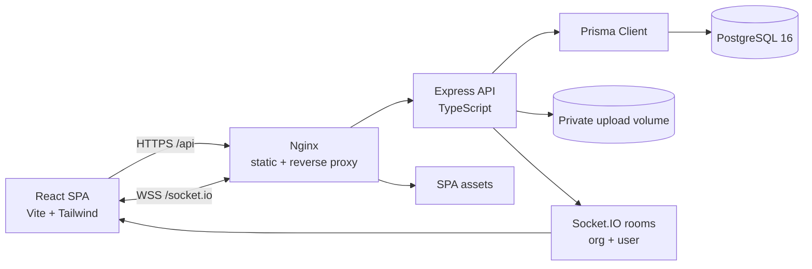

# Architecture

## Runtime topology



The monorepo keeps two deployable applications:

- `apps/api` — Express + Prisma + Socket.IO, built with `tsup` into a single ESM server bundle.
- `apps/web` — React SPA, built with Vite, served by Nginx in production. Nginx proxies `/api` and `/socket.io` to the API service.

Docker Compose wires `web → api → postgres`. Migrations run at API container start (`prisma migrate deploy`). Demo seeding is an explicit tools profile command so restarts never destroy data.

## Request lifecycle

1. **Transport hardening** — Helmet headers, explicit CORS allow-list with credentials, 1 MB JSON limit, cookie parsing.
2. **Origin check** — state-changing requests with an `Origin` header must match `CLIENT_ORIGIN`.
3. **Rate limiting** — global API bucket plus a stricter authentication bucket (in-memory store; see scale notes).
4. **CSRF** — cookie-authenticated mutations require `X-CSRF-Token` equal to the `tf_csrf` cookie. Bearer clients are exempt; login/register/refresh are exempt because they establish the cookie.
5. **Authentication** — `authenticate` accepts the `tf_access` HttpOnly cookie or an `Authorization: Bearer` access token, verifies the HS256 JWT, then loads the user from the database.
6. **Organization resolution** — `requireOrg` resolves `:orgId`, loads the caller's `Membership`, and attaches it. Missing memberships produce `404` (no organization enumeration).
7. **Input validation** — Zod schemas parse bodies and queries, returning structured `400` errors.
8. **Authorization** — capability checks (`requireCapability`) for org-level actions; `getProjectContext` / `getTaskContext` for resource-level actions, combining org role and project role.
9. **Persistence** — Prisma with explicit selects/includes. Mutations that span tables use transactions.
10. **Side effects** — activity records, audit records, notifications, and Socket.IO broadcasts. Activity/notification failures are logged but never roll back the user's mutation.

## Tenant isolation model

Every tenant-owned table carries `organizationId`: projects, tasks, attachments, notifications, activity, audit logs, invitations, categories. Related tables reach the tenant through their parent (e.g. comments → task).

Access always follows this path:

```
Authenticated user
  → Membership(userId, organizationId)        // must exist
    → Project(organizationId)
      → ProjectMember (optional, adds/narrows capabilities)
        → Task(projectId)
```

- A resource ID from another tenant is treated as **not found**, not forbidden. This avoids leaking existence.
- Task lookup ignores the caller-supplied project: it loads the task, then resolves the project and membership from the task's own `organizationId`.
- List endpoints always filter by the resolved organization rather than trusting query/body tenant values.
- `tests/isolation.test.ts` asserts isolation across project/task reads and writes, dashboards, analytics, workload, search, notifications, comments, dependencies, and cross-tenant assignments.

## Authorization

Capabilities are defined once in `apps/api/src/domain/permissions.ts`; the web app mirrors them only for UI affordances, never as the enforcement point.

| Capability | Owner | Admin | PM | Team Lead | Developer | Viewer |
| --- | :-: | :-: | :-: | :-: | :-: | :-: |
| Org settings / audit | ✓ | ✓ | — | — | — | — |
| Members & invitations | ✓ | ✓ | — | — | — | — |
| Departments | ✓ | ✓ | — | — | — | — |
| Teams | ✓ | ✓ | ✓ | ✓ | — | — |
| Create projects | ✓ | ✓ | ✓ | ✓ | — | — |
| Manage project / workflow | ✓ | ✓ | ✓ | ✓ | — | — |
| Create/update tasks | ✓ | ✓ | ✓ | ✓ | ✓ | — |
| Delete tasks | ✓ | ✓ | ✓ | ✓ | — | — |
| Sprints / milestones | ✓ | ✓ | ✓ | ✓ | — | — |
| Comments / attachments | ✓ | ✓ | ✓ | ✓ | ✓ | — |
| Reports | ✓ | ✓ | ✓ | ✓ | ✓ | ✓ |

Project membership additionally applies:

- `MANAGER` grants project-scoped management (project settings, workflow, sprints, milestones, task deletion).
- `CONTRIBUTOR` grants task/comment/attachment writes.
- `VIEWER` is a hard restriction: project write capabilities are removed even if the organization role would allow them.

Guardrails: only an Owner may manage another Owner or assign Owner; the last Owner cannot be demoted or removed; Admins cannot escalate to Owner; invitations cannot grant Owner.

## Authentication design

| Concern | Implementation |
| --- | --- |
| Password storage | Node `scrypt` (N=16384, r=8, p=1), 16-byte random salt, 64-byte key, `timingSafeEqual` verification, versioned `scrypt$...` format |
| Access token | Signed HS256 JWT, 15 min default, HttpOnly + SameSite=Lax cookie, optional Bearer for API clients |
| Refresh token | 48-byte opaque token; SHA-256 hash stored in `RefreshToken`; 30-day expiry; HttpOnly cookie scoped to `/api/auth`; rotated on every refresh with replay revocation |
| CSRF | Non-HttpOnly `tf_csrf` cookie + required `X-CSRF-Token` header (double submit, timing-safe compare) |
| Login timing | Unknown emails still run scrypt against a dummy hash |
| Session revocation | Logout, password change, and refresh rotation revoke stored tokens |
| Cookies | `COOKIE_SECURE` defaults to true in production; `COOKIE_DOMAIN` configurable |
| Audit | Logins, failures, registrations, role changes, invitations, deletions, exports, project changes |

## Real-time architecture

- Socket.IO authenticates using the same HttpOnly access cookie (or `handshake.auth.token`).
- On connection, the socket joins `user:{id}` and an `org:{organizationId}` room for each membership.
- Services emit events after successful mutations: `task:created`, `task:updated`, `task:moved`, `task:deleted`, `comment:*`, `project:*`, `sprint:*`, `milestone:*`, `workflow:updated`, `attachment:*`, `activity:created`, and per-user `notification`.
- The SPA invalidates relevant React Query caches and displays notification toasts. Socket events are advisory; every client still refetches through authenticated REST endpoints.
- The emitter is isolated in `realtime.ts`. For horizontal scale, add the Socket.IO Redis adapter and a shared rate-limit store; no route code changes are required.

## Analytics definitions

| Metric | Definition |
| --- | --- |
| Open tasks | Non-archived tasks whose column is not marked done |
| Overdue | Open task with `dueDate < now` |
| Completion rate | Done / all non-archived tasks |
| On-time rate | Completed tasks with a due date where `completedAt <= dueDate` |
| Cycle time | Average `completedAt - createdAt` for tasks completed in the range |
| Throughput | Created vs completed tasks per ISO week |
| Burndown | Remaining sprint tasks per day vs ideal linear burn; uses task `completedAt` |
| Velocity | Completed tasks/points for completed sprints |
| Workload | Assigned open tasks, overdue count, high/urgent count, estimated hours; overload thresholds configurable per organization |

Workload and delivery metrics are explicitly framed as planning signals. The product avoids ranking employees or equating activity counts with performance.

## File uploads

- `multer` disk storage with random UUID filenames and no client-controlled paths.
- MIME allow-list (images, PDF, text/markdown/CSV/JSON, ZIP, DOCX, XLSX) and configurable 10 MB limit.
- Attachments are never publicly served. Download resolves the task → project → membership and streams with `Content-Disposition: attachment` and `nosniff`.
- Deleting an attachment removes the database row and stored file; upload failures clean up orphaned files.

## Calendar integration

The calendar API returns normalized events (`task`, `milestone`, `sprint`) with project metadata, dates, status, and assignees. This deliberately separates presentation from source entities so an adapter layer can add:

- ICS feed generation (`/calendar.ics`) for read-only subscriptions.
- Google Calendar / Microsoft Graph sync with external event IDs mapped in a future `CalendarConnection` table.
- Webhook-driven updates; the existing activity/event stream is the trigger point.

## Key trade-offs and limitations

- **Analytics aggregation in application code** keeps queries portable and easy to reason about at demo scale. At larger scale, move weekly/trend aggregates into SQL or a materialized view.
- **In-process rate limiting and Socket.IO fan-out** are simple and dependency-free but single-node. Documented production path: Redis store + adapter.
- **Local disk uploads** suit a single container. Production path: S3-compatible object storage with signed URLs and malware scanning.
- **Invitation email is not sent.** Secure links are returned to the inviting admin for delivery through a real email provider. The UI states this rather than faking delivery.
- **Archive instead of hard delete for projects** preserves task/report history while removing projects from active views.
- **Soft analytics caveat** is a product decision: no per-employee performance scoring is exposed.
