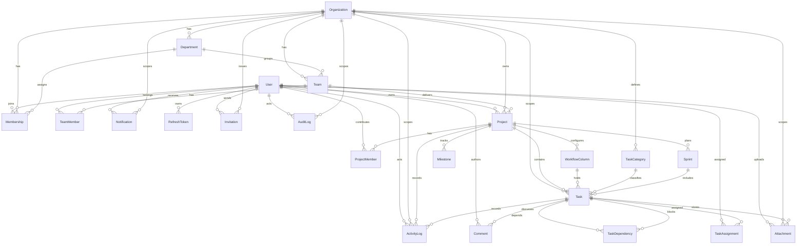

# Database design

PostgreSQL 16 with Prisma. The schema lives at [`apps/api/prisma/schema.prisma`](../apps/api/prisma/schema.prisma), the initial migration at `apps/api/prisma/migrations/`, and demo data in `apps/api/prisma/seed.ts`.

## Entity relationship diagram



## Core tables

| Table | Purpose | Key constraints |
| --- | --- | --- |
| `User` | Global identity and profile | `email` unique |
| `Organization` | Tenant boundary; JSON settings | `slug` unique |
| `Membership` | User ↔ organization role, title, department | unique `(userId, organizationId)`; indexed `(organizationId, role)` |
| `Department` | Org subdivision with optional lead | unique `(organizationId, name)` |
| `Team` | Delivery team in a department | unique `(organizationId, name)` |
| `TeamMember` | Team membership and team role | unique `(teamId, userId)` |
| `Invitation` | Secure, expiring invite with role | `token` unique; indexed `(organizationId, status)` |
| `Project` | Delivery initiative; owner, team, status, dates | unique `(organizationId, key)`; indexed `(organizationId, status)` |
| `ProjectMember` | Project role (`MANAGER`, `CONTRIBUTOR`, `VIEWER`) | unique `(projectId, userId)` |
| `WorkflowColumn` | Configurable board column; `isDone`, WIP limit, position | unique `(projectId, name)` |
| `TaskCategory` | Org-wide task classification | unique `(organizationId, name)` |
| `Task` | Work item; number per project, status via column, estimates, dates, completion | unique `(projectId, number)`; indexes on project/column/sprint/due date/priority/completion |
| `TaskAssignment` | Many-to-many assignees | unique `(taskId, userId)` |
| `TaskDependency` | `taskId` depends on `dependsOnTaskId` | unique pair; indexed on blocker; cycle prevention in service |
| `Comment` | Task discussion | indexed `(taskId, createdAt)` |
| `Attachment` | Validated private file metadata | `storageKey` unique; indexed by task/org |
| `Sprint` | Timeboxed iteration | unique `(projectId, name)`; indexed `(projectId, status)` |
| `Milestone` | Delivery checkpoint | indexed `(projectId, dueDate)` |
| `Notification` | Per-user realtime/read state | indexed `(userId, readAt)` |
| `ActivityLog` | Human-readable project/task history | indexed by org/project/task + time |
| `AuditLog` | Security-relevant actions with IP/user agent | indexed `(organizationId, createdAt)` |
| `RefreshToken` | Hashed rotating refresh sessions | `tokenHash` unique; indexed by user/expiry |

## Design decisions

**Task status is the workflow column.** There is no separate status enum to drift from the board. A column marked `isDone` drives completion, sprint progress, and analytics; moving into it sets `completedAt`, moving out clears it. Completion timestamps are preserved for historical velocity/burndown.

**Atomic per-project numbering.** `Project.taskCounter` is incremented inside the same transaction that creates a task, and `(projectId, number)` is unique. Human-readable keys (`ATLAS-42`) stay stable and race-safe under concurrent creation.

**Tenant denormalization where it matters.** `Task`, `Attachment`, `Notification`, `ActivityLog`, and `AuditLog` carry `organizationId` so isolation checks and analytics queries never require joining through several parents. The API validates relationships when writing.

**Dependency direction.** `TaskDependency.taskId` is the blocked task; `dependsOnTaskId` is the blocker. Cycle prevention walks the project's dependency graph before insert. Deleting either end cascades the edge.

**History survives destructive actions.** Project deletion archives (`archived=true`, status `ARCHIVED`) rather than cascading. Task deletion cascades comments, attachments, assignments, dependencies, and leaves activity rows with `taskId` set null so the trail remains.

**Ordering.** Tasks use a float `position` for drag-and-drop inserts between neighbors; new tasks append by +1000. Columns use integer positions. Stable sorting falls back to creation time.

**Completion semantics.** `completedAt` is nullable and is the single source for burndown, cycle time, velocity, and on-time delivery. Sprint completion does not rewrite it; incomplete tasks stay attached to the sprint so reports remain accurate until carry-over.

## Indexes

Hot paths are covered explicitly:

- Tenant reads: `(organizationId, ...)` on projects, tasks, activity, audit, notifications, attachments.
- Board rendering: `(projectId)` + `columnId`, `(projectId, number)`.
- Sprint/report queries: `sprintId`, `(projectId, status)`.
- Planning: `dueDate`, `(priority, archived)`, `completedAt`.
- Collaboration: `(taskId, createdAt)` comments, `(userId, readAt)` notifications.
- Sessions: `(userId)`, `expiresAt`, unique token hash.

Search currently uses PostgreSQL `ILIKE` (`contains`, case-insensitive) over titles/descriptions/names. For larger corpora, add `pg_trgm` GIN indexes or a dedicated search service; the endpoint contract stays the same.

## Migrations and seeding

```bash
npm run db:generate   # Prisma client
npm run db:migrate    # prisma migrate dev (development)
npm run db:deploy     # prisma migrate deploy (CI / production)
npm run db:seed       # reset the two demo organizations and seed content
npm run db:reset      # migrate reset + seed
```

Tests use a separate database (`TEST_DATABASE_URL`, default `teamflow_test`). `tests/global-setup.ts` applies migrations and clears test data without touching developer/demo databases.
